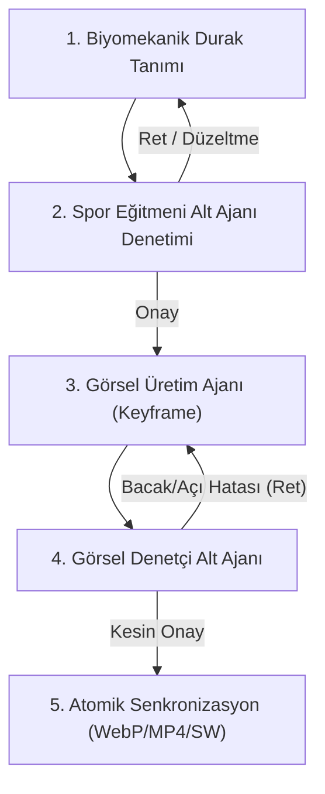

# 🎬 Egzersiz Görsel Üretim ve Biyomekanik Doğrulama Hattı (Visual Pipeline)

Bu beceri; yeni bir hareket eklendiğinde veya görseli güncellendiğinde **asla yanlış, eksik veya yanıltıcı görsel atanmamasını** garanti eden 5 aşamalı kapalı devre denetim sistemidir.

---

## 🛑 KATI VE DEĞİŞMEZ İLKELER

1. **Yanıltıcı Fallback Yasağı:** Bir hareketin görseli yoksa başka bir hareketin görseli veya adı ASLA bağlanamaz (`mach_straight_arm_pulldown`'a `Pullover` basılamaz). Görsel hazır değilse nötr `placeholder.webp` gösterilir.
2. **Kural 8 Tercih Protokolü:** Görsel üretiminde kullanıcı açıkça belirtmedikçe Canva vs AI kararı tek başına verilemez; kullanıcıya sorulur.
3. **Piksel Bütçesi:** Mobil PWA performansı için animasyonlu WebP dosyası **150 KB**, MP4 video **300 KB** sınırını aşamaz.
4. **Çift Alt Ajan Filtresi:** Hiçbir görsel, hem **Spor Eğitmeni** hem de **Görsel Denetçi** alt ajanının onayından geçmeden ana kütüphaneye (`exercises-db.js`, `app.js`, `desktop-app`) eklenemez.

---

## 🔄 5 AŞAMALI BORU HATTI (PIPELINE)

### 1. Aşama: Biyomekanik Durak (Waypoint) Şablonu
Her hareket için şu 5 parametre zorunlu olarak doldurulur:
- **Durak 1 (Başlangıç):** Ayak tabanı, diz açısı, omurga/pelvis açısı, el tutuşu ve ekipman konumu.
- **Manevra 1 -> 2 (Geçiş):** Hareketi başlatan primer kas/eklem, sabit kalacak pivot eklem, kinetik yön.
- **Durak 2 (Zirve / İstasyon):** Tepe kasılma veya ilk fazın bitiş koordinatı.
- **Manevra 2 -> 3 (İkinci Faz):** Bileşik hareketin ikinci parçasına akış kuralı (valgus ve kifoz yasakları).
- **Durak 3 (Bitiş & Reset):** Eksantrik iniş ve başlangıç pozisyonuna döngüsel bağlanış.

### 2. Aşama: Spor Eğitmeni Denetimi (`Sports Biomechanics Trainer`)
- `invoke_subagent` ile `self` model çağrılır.
- **Denetim Soruları:**
  - Omurga eksenel yükü güvenli mi (L5-S1 kesme kuvveti, boyun fleksiyonu)?
  - Modelin bacakları karıştırmaması için **Pivot Ayak** ve **Sarkaç Bacak** açıkça ayrılmış mı?
- Hata varsa tanım düzeltilir; onay gelince 3. aşamaya geçilir.

### 3. Aşama: Görsel Üretim Ajanı (`image-generator` veya Canva)
- Onaylı durak koordinatlarıyla her durak için tekil anahtar kare (Keyframe) üretilir:
  - `prototypes/generated_keyframes/{id}_waypoint_f1.jpg`
  - `prototypes/generated_keyframes/{id}_waypoint_f2.jpg`
  - `prototypes/generated_keyframes/{id}_waypoint_f3.jpg`
- Kamera açısı, sporcu kıyafeti ve salon arka planı tüm karelerde kilitlenir.

### 4. Aşama: Görsel Kalite & Açı Denetçisi (`Visual Biomechanical Auditor`)
- Görsel denetim alt ajanı üretilen kareleri tek tek inceler:
  - Durak 1, 2 ve 3 eksiksiz mevcut mu?
  - Eklem açıları (90° diz, dik omurga) korunmuş mu?
  - Bacak değişimi (Seesaw / Lunge döngüsü) doğru mu yoksa yapay zeka aynı bacağı mı tekrarlamış?
  - Yapay zeka deformasyonu (eriyen dambıl, fazla parmak) var mı?
- **Ret:** Hatalı kare spesifik direktifle 3. aşamaya geri gönderilir.
- **Onay:** 5. aşamaya geçilir.

### 5. Aşama: Atomik Senkronizasyon & Paketleme
Onaylı kareler tek bir Python komutuyla işlenir:
1. `assets/opengym/stills/{id}.webp` (Kapak afişi)
2. `assets/exercises/{id}.webp` (Durak döngülü WebP animasyonu, < 150 KB)
3. `assets/opengym/clips/{id}.mp4` (H.264 Baseline, < 300 KB)
4. `js/exercises-db.js` -> `guideLibrary` ve `exerciseGuideMap` güncellenir.
5. `sw.js` ve `desktop-app/src/services/exercise-catalog.js` dosyalarına yeni medya eklenir.
