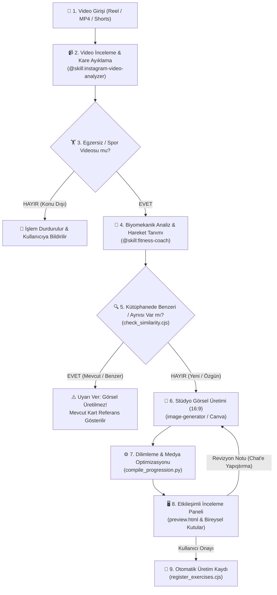

# 🎬 fitvid_generate (Video-to-Exercise Pipeline)

Bu beceri; kullanıcı bir video bağlantısı (**YouTube Shorts, YouTube videosu, Instagram Reels, TikTok** veya yerel video dosyası) paylaştığında, ham videodan başlayarak **Çelik Kodu** standartlarında eksiksiz, bilimsel ve üretime hazır egzersiz kartları üreten ana orkestratördür.

> [!TIP]
> **🎯 TEMEL MİSYON: FONKSİYONEL HİBRİT & KOMBO HAREKET AVCISI**
> Bu becerinin birincil varoluş amacı:
> - Sosyal medyada ve antrenör videolarında görülen **yüksek metabolik değerli, yaratıcı ve fonksiyonel birleşik hareketleri (hibrit komboları / complex flow)** tersine mühendislikle videodan çekip almak (çalmak).
> - Hareketin kinetik zincirini, geçiş pivotlarını ve kasılma açılarını çözmek.
> - Çıkarılan bu hibritleri **kendi oluşturacağımız fonksiyonel antrenman programlarına (Çelik Kodu Dev Setleri, Circuit, Kettlebell/Dambıl Flow, A1/A2 blokları)** anında dahil edilebilecek eksiksiz bir programlama kartına dönüştürmektir.

> [!IMPORTANT]
> **🛑 1. KURAL: SPOR & FITNESS UYGUNLUK KAPISI (RELEVANCE GUARD)**
> Gelen video fitness, spor salonu, antrenman, kalisteniks, serbest ağırlık, kettlebell/dambıl veya insan biyomekaniği/egzersiz hareketi **İÇERMİYORSA İŞLEM YAPILMAZ!**
> - Görsel üretimi başlatılmaz, alt ajanlar tetiklenmez, işlem anında durdurulur.
>
> **🛑 2. KURAL: MÜKERRER & BENZER HAREKET GÖRSEL YASAĞI (SIMILARITY GATE)**
> Kütüphanemizde (`js/exercises-db.js`, 115+ egzersiz) **zaten mevcut olan veya biyomekanik olarak %75+ benzerlik gösteren** hareketler için **ASLA YENİ GÖRSEL ÜRETİLMEZ!**
> - Sistem derhal uyarı verir: *"⚠️ [Hareket Adı] kütüphanemizdeki [Mevcut ID - Adı] hareketiyle birebir aynı/benzerdir. Mükerrer görsel üretilmedi; mevcut kart referans gösterildi."*
> - Yalnızca kütüphanede bulunmayan **tamamen yeni/özgün** varyasyonlar görsel üretim aşamasına geçebilir.
>
> **🛑 3. KURAL: FONKSİYONEL HİBRİT & DEV SET BÜTÜNLÜĞÜ (CIRCUIT & HYBRID FLOW)**
> - **6 Hareket = 1 Dev Set:** Videodaki 6 hareketlik akış bir "Dev Set / Circuit" turudur. Her hareket peş peşe 1'er kez yapılarak 1 tam tur (set) tamamlanır.
> - **2 Fazlı Hibritler ASLA Bölünmez:** Fonksiyonel fitness hareketleri genellikle 2 hareketin kesintisiz kinetik zinciridir (örn: *Dambıl Squat to Overhead Press*, *Rotational Lunge to Chop*, *Row to High Pull & Cuban Rotation*).
> - Bu hareketler asla 2 ayrı egzersize parçalanmaz! Kinetik zincir boyunca tek bir bileşik hareket (`isComplex: true`, `mechanic: "compound"`) olarak tanımlanır.
> - 5 Aşamalı durak yapısı bu hibritleri eksiksiz modellemek için tasarlanmıştır:
>   - **Durak 1:** 1. Faz Başlangıcı (örn. Squat / Lunge tabanı)
>   - **Durak 2:** 1. Faz İvmesi (örn. Doğrulma)
>   - **Durak 3:** İki Faz Arası Pivot / Geçiş (örn. Omuza dambıl aktarımı, gövde rotasyonu)
>   - **Durak 4:** 2. Faz Zirvesi (örn. Baş üstü pres kilitlenmesi)
>   - **Durak 5:** Eksantrik Kontrol & Reset (örn. Başlangıç pozisyonuna sıfırlanma)
> - **Benzerlik Koruma Ayrımı:** Bir hibrit hareket (örn. *Squat to Press*), sırf içinde "Squat" geçiyor diye tek başına kütüphanedeki "Squat" ile eşleştirilip engellenemez. Yalnızca kütüphanede **aynı hibrit kombinasyon** varsa benzer sayılır.

İçerisinde 3 uzman beceriyi ve yerleşik otomasyon betiklerini tam uyumla çalıştırır:
1. **`@skill:instagram-video-analyzer`**: Videoyu indirir, 10 fps karelere böler, hareket zaman aralıklarını çıkarır.
2. **`@skill:fitness-coach`**: Egzersiz formunu, primer/sekonder kasları, güvenlik sınırlarını ve 5 aşamalı biyomekanik durak haritasını çıkarır.
3. **`@skill:exercise-visual-pipeline`**: Yapay zeka halüsinasyonlarını önleyen görsel kurallarla 16:9 stüdyo şeritleri üretir.

---

## 🏗️ Mimari & İş Akışı (Workflow)



---

## 📋 Operasyon Protokolü

### 0. Aşama: Fitness & Spor Uygunluk Doğrulaması (Pre-Flight Filter)
Video indirildikten ve ilk kareler incelendikten sonra ilk olarak içerik kontrolü yapılır:
- Videoda bir insan fiziksel bir egzersiz, antrenman manevrası, esneme veya biyomekanik hareket yapıyor mu?
- **Eğer hayır ise:** İşlem derhal sonlandırılır, hiçbir görsel üretilmez veya alt ajan çağrılmaz.
- **Eğer evet ise:** 1. Aşamaya geçilir.

### 1. Aşama: Video Ayrıştırma & Hareket Tespiti
Kullanıcı bir video bağlantısı paylaştığında:
1. `instagram-video-analyzer` betiğini çalıştırarak videoyu `/tmp/` dizinine indirin ve kareleri çıkarın:
   ```bash
   python3 .agents/skills/instagram-video-analyzer/scripts/extract_reel.py "<VIDEO_URL>"
   ```
2. Video içerisindeki her bir egzersizin saniye aralıklarını (örn. 00:00-00:05 Lunge, 00:06-00:11 Gorilla Row vb.) tespit edin.

---

### 2. Aşama: Biyomekanik Tanım & 5 Aşamalı Durak Haritası
`fitness-coach` prensiplerine göre her hareket için şu şablonu doldurun:

```json
{
  "id": "db_movement_id",
  "name": "Türkçe Hareket Adı",
  "category": "legs_quad | pull | push | posterior_chain | core | full_body",
  "mechanic": "compound",
  "isComplex": true,
  "program_role": "Metabolik Finisher | Dev Set İstasyonu | Rotasyonel Güç | Ana Kompleks",
  "kinetic_flow": "1. Faz (Lunge/Squat) -> Pivot Aktarım -> 2. Faz (Chop/Press)",
  "superset_partner": "Antagonist veya zıt zincir hareket eşleşmesi",
  "primary_muscles": ["quads", "glutes"],
  "secondary_muscles": ["core", "shoulders"],
  "protocol": "3-4 Tur Dev Set x 8-10 Tekrar | RPE 8 | 60-90 sn Dinlenme",
  "cue": "Kısa, vurucu koç ipucu",
  "stages": [
    {"stage": 1, "short_name": "1. Kurulum", "desc": "1. Faz başlangıç eklem açıları, el tutuşu, omurga nötr."},
    {"stage": 2, "short_name": "2. Geçiş 1-2", "desc": "1. Faz ivmesi, primer kasın sürüşü."},
    {"stage": 3, "short_name": "3. Pivot / Zirve", "desc": "1. ve 2. faz arasındaki kinetik aktarım / rotasyonel pivot."},
    {"stage": 4, "short_name": "4. Geçiş 2-3", "desc": "2. Fazın zirve kasılması (pres, çekiş veya savuruş kilidi)."},
    {"stage": 5, "short_name": "5. Bitiş / Reset", "desc": "Eksantrik kontrollü iniş ve başlangıç pozisyonuna sıfırlanış."}
  ]
}
```

---

### 2.5. Aşama: Egzersiz Tekillik & Benzerlik Denetimi (Duplicate / Similarity Gatekeeper)
Görsel üretim istemi hazırlamadan önce, tespit edilen hareketler projedeki 115+ egzersizlik ana katalogla taranır:

```bash
node .agents/skills/fitvid_generate/scripts/check_similarity.cjs "<spec.json | 'hareket_adi'>"
```

- **🛑 DUPLICATE (Tam Eşleşme / Mükerrer):** Hareket zaten kütüphanede vardır. Görsel üretilmez, mevcut kart referans gösterilir.
- **⚠️ SIMILAR (%75+ Kuvvetli Benzerlik):** Benzer biyomekanik mekanizma tespit edilmiştir. Görsel üretimi durdurulur ve kullanıcıya fark bildirilir.
- **✅ UNIQUE (Özgün / Yeni):** Kütüphanede benzeri yoktur; 3. Aşamaya (Görsel Üretim) geçmesine izin verilir.

---

### 3. Aşama: Stüdyo Standartlarında Görsel Üretimi (Yalnızca Özgün Hareketler)
`exercise-visual-pipeline` kuralları uyarınca prompt hazırlanır ve `image-generator` alt ajanına aktarılır.

> [!IMPORTANT]
> **🛑 KATI MASTER REFERANS ATLET KURALI (MASTER ATHLETE ANCHOR)**
> Tüm görsel üretimlerinde rastgele model çizimi YASAKTIR. Doğrudan şu master referans görseli esas alınır:
> - **Referans Dosya:** `.agents/skills/fitvid_generate/assets/master_athlete_neutral.png` (veya `assets/opengym/master_athlete_neutral.png`)
> - **Kural:** Üretilen her figür bu referanstaki atletik erkeğin yüz hatlarını, saç kesimini, kafa/boyun proporsiyonunu ve kas hatlarını birebir taşımak zorundadır.
>
> **5 Katı Stüdyo Kuralı:**
> 1. **Boyut:** `AspectRatio: "16:9"` (Geniş panoramik stüdyo şeridi).
> 2. **Master Model:** Referans dosyadaki (`master_athlete_neutral.png`) aynı atletik erkek model; koyu gri kolsuz atlet ve siyah şort.
> 3. **Negatif Boşluk:** Figürler arasında en az 60-80 piksel net boşluk (asla birbiriyle temas etmeyen 5 figür).
> 4. **Zemin & Arka Plan:** Koyu antrasit/arduvaz stüdyo fonu (`#111827`), yumuşak zemin temas gölgeleri, göz hizasında kilitli tripod kamera.
> 5. **Uzuv & El Tutarlılığı (Anti-Hallucination):** Tek dambıl kullanılıyorsa 5 karede de AYNI elde tutulmalı (kol değişimi YASAK). İki el tutuşunda dambıl kupa tutuşu 5 karede de sabit kalmalıdır.

**Örnek Prompt Şablonu:**
```text
A wide panoramic 16:9 fitness studio sequence photograph showing 5 clearly separated, non-overlapping biomechanical progression stages of [EXERCISE_NAME], arranged horizontally from left to right:
CRITICAL MASTER ATHLETE REFERENCE: ALL 5 figures depict the EXACT SAME athletic muscular man from the master reference image (master_athlete_neutral.png), with identical facial features, short dark hair, and muscular proportions.
CRITICAL SPACING RULE: Ensure generous empty negative space (at least 60-80 pixels of empty dark studio background) between each adjacent figure. ABSOLUTELY NO OVERLAPPING or touching limbs between the figures.
CRITICAL LIMB CONSISTENCY: The athlete holds the dumbbell in the EXACT SAME ARM across ALL 5 stages. ZERO arm switching.
- Stage 1 (left): Setup: ...
- Stage 2 (second): Transition: ...
- Stage 3 (middle): Peak Apex: ...
- Stage 4 (fourth): Controlled Eccentric: ...
- Stage 5 (right): Reset: ...
ALL 5 figures wear identical dark grey sleeveless compression tank top, black training shorts, and black sneakers with white soles.
Camera is LOCKED on a static wide tripod at eye-level from a uniform 45-degree angle.
Seamless dark slate studio floor and background (#111827) with subtle soft floor contact shadows. Clean, high contrast commercial fitness photography.
```

---

### 4. Aşama: Otomatik Dilimleme ve Medya Paketleme
Görseller üretildikten sonra yerleşik derleme betiği çalıştırılır:

```bash
# Tek bir hareket için:
python3 .agents/skills/fitvid_generate/scripts/compile_progression.py \
  --dir "review_staging/exercise_cards_review/01_movement_id" \
  --image "/path/to/generated_strip.jpg"

# Veya tüm hareketleri içeren JSON şartnamesi ile toplu işlem:
python3 .agents/skills/fitvid_generate/scripts/compile_progression.py \
  --spec "review_staging/exercise_cards_review/specifications.json"
```

Bu betik otomatik olarak:
- Figürleri dikey piksel yoğunluğuna göre algılar ve ayırır.
- Her figürü 768x768 kare tuvalin merkezine (`x=384`) yerleştirir.
- `ai_progression_strip.jpg` (3840x768 birleşik şerit) oluşturur.
- Çift yönlü döngülü (`1->2->3->4->5->4->3->2`) optimize `ai_animation.webp` üretir (**< 150 KB**).
- `ffmpeg` ile H.264 Baseline `ai_clip.mp4` video klibi üretir (**< 300 KB**).

---

### 5. Aşama: Etkileşimli İnceleme Paneli (`preview.html`)
Kullanıcının her hareketi tek ekranda inceleyebilmesi ve geri bildirim verebilmesi için staging galerisi üretilir:

```bash
python3 .agents/skills/fitvid_generate/scripts/generate_review_board.py \
  --spec "review_staging/exercise_cards_review/specifications.json" \
  --out "review_staging/exercise_cards_review/preview.html"
```

**Galeri Özellikleri:**
- Canlı WebP animasyonu ve MP4 video oynatıcı geçiş butonu.
- 5 aşamalı tıklanabilir durak sekmeleri ve detaylı biyomekanik açıklamalar.
- Tam boy 5 aşamalı ilerleme şeridi.
- **Her hareket için bağımsız geri bildirim metin kutusu ve kopyalama butonu.**
- **Toplu Rapor Toplayıcı:** Tek tıkla tüm kutulardaki notları yapılandırılmış markdown raporuna dönüştürür.

---

### 6. Aşama: Revizyon Döngüsü & Üretim Kaydı

#### Revizyon Geldiğinde:
- Onaylanan hareketlere tekrar dokunulmaz.
- Yalnızca revizyon istenen hareket için prompt güncellenir ve yeniden üretilir.
- `preview.html` içindeki "Bu Turda Yapılan Biyomekanik Düzeltmeler" (changelog) kutusuna yapılan düzeltme maddeleri eklenir.

#### Tam Onay Geldiğinde (`"onayladım, kaydet"`):
Kullanıcı onay verdiği an otomatik kayıt betiği çalıştırılır:

```bash
node .agents/skills/fitvid_generate/scripts/register_exercises.cjs \
  "review_staging/exercise_cards_review/specifications.json" \
  "review_staging/exercise_cards_review"
```

Bu betik sırasıyla:
1. `ai_animation.webp` dosyasını `assets/exercises/{id}.webp` yoluna taşır.
2. `ai_clip.mp4` dosyasını `assets/opengym/clips/{id}.mp4` yoluna taşır.
3. `ai_still.webp` dosyasını `assets/opengym/stills/{id}.webp` yoluna taşır.
4. `js/exercises-db.js` içine `EXERCISES_DB`, `guideLibrary` ve `exerciseGuideMap` kayıtlarını ekler.
5. `js/app.js` içine `EXERCISE_MUSCLE_BREAKDOWN` ve `OPENGYM_PREVIEWS` objelerini ekler.
6. `sw.js` içine yeni varlıkları önbellek listesine yazar.
7. Tüm dosyalarda `node -c` çalıştırarak **sözdizimi hatası olmadığını doğrular**.

> [!CAUTION]
> **KATI KURAL:** Asla `git push` çalıştırılmaz! Canlıya alma işlemi yalnızca kullanıcı doğrudan talimat verdiğinde `GEMINI.md` Canlıya Çıkış Protokolü uyarınca yapılır.
