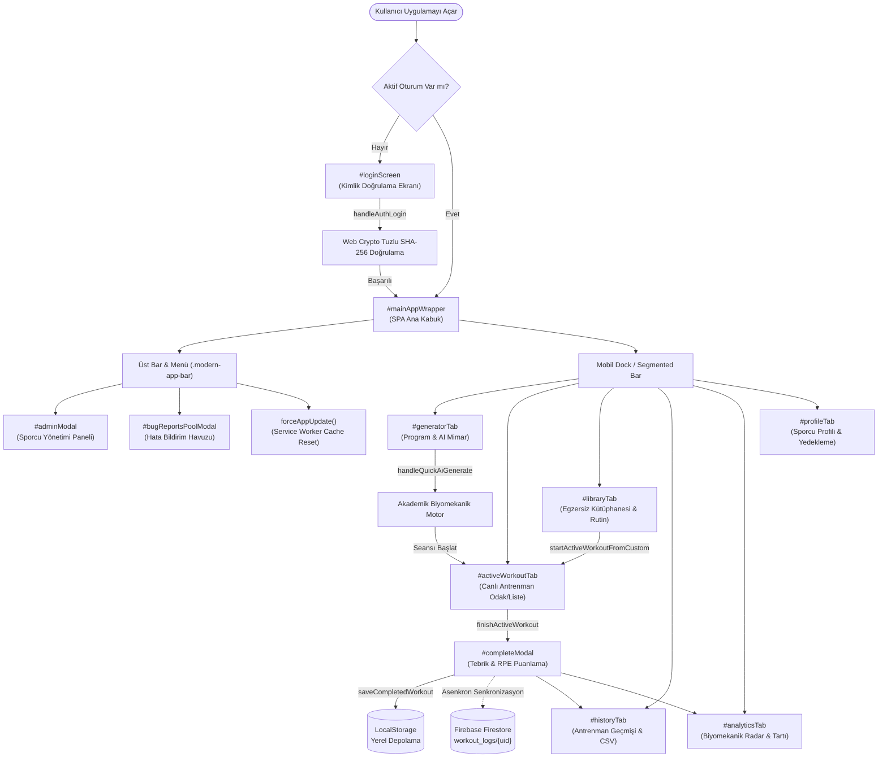
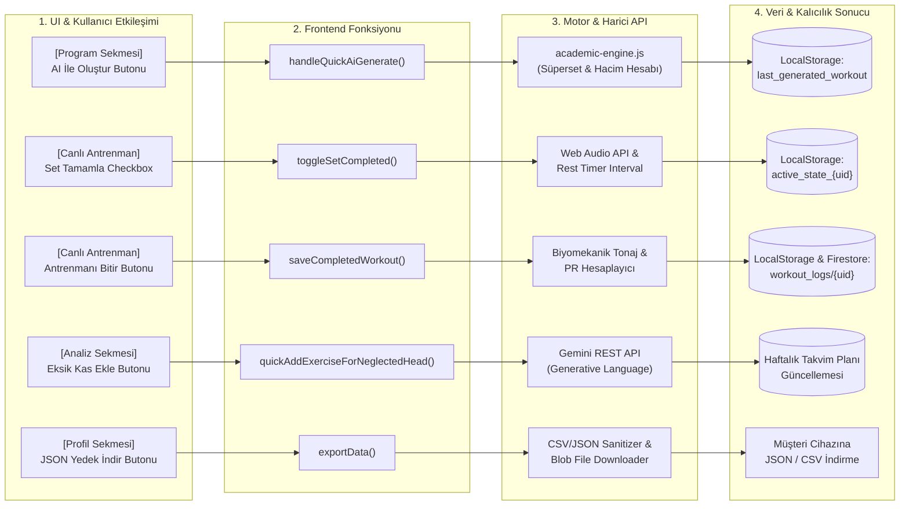
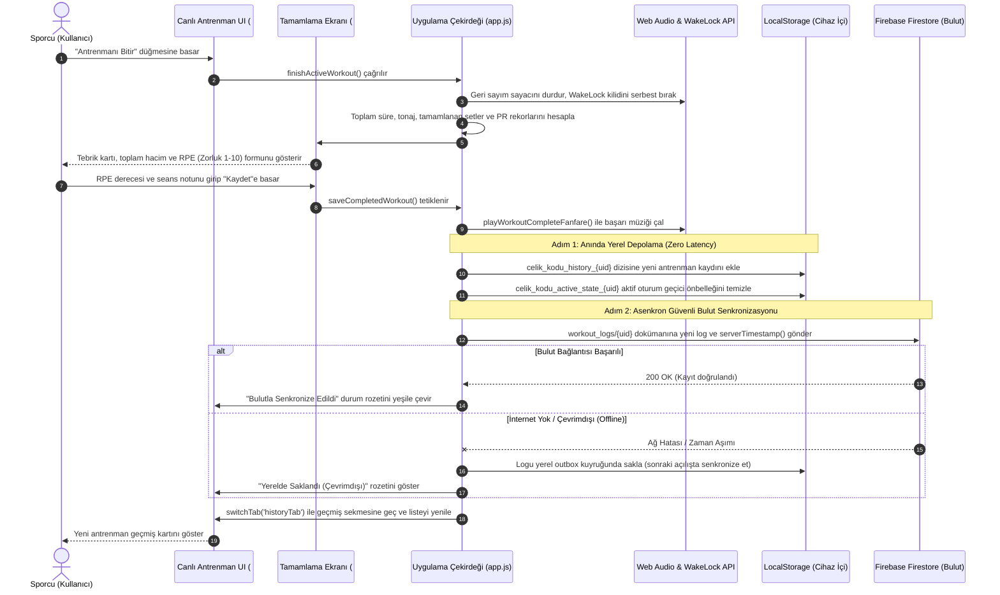

# Çelik Kodu (Fitness PWA & Desktop) — Uygulama İşlevsellik & Mimari Haritası (APP_FLOW.md)

Bu doküman, **Çelik Kodu** projesindeki tüm arayüz bileşenlerini, kullanıcı etkileşim tetikleyicilerini (UI triggers), arka planda çalışan JavaScript fonksiyonlarını, harici API entegrasyonlarını, yerel/bulut veritabanı işlemlerini ve sistem akış şemalarını eksiksiz olarak haritalandırır.

---

## 1. Sayfa ve Görünüm Taraması (Pages, Views & Modules)

Uygulama, hem mobil PWA (Progressive Web App) hem de masaüstü (Electron Coach Station) ortamlarında çalışan, yerel öncelikli (local-first) hibrit bir mimariye sahiptir.

| Görünüm / Rota | DOM ID / Konum | Tip / Kapsam | Temel Sorumluluk |
|---|---|---|---|
| **Giriş & Kimlik Doğrulama** | `#loginScreen` | Ekran / View | Salted SHA-256 kimlik doğrulama, kullanıcı seçimi, yönetici girişi, oturum başlatma |
| **Ana Uygulama Kapsayıcısı** | `#mainAppWrapper` | SPA Ana Kabuk | Üst bar (header), bildirimler, sürüm takibi ve aktif sekme yönetimi |
| **1. Program & AI Mimar** | `#generatorTab` | Ana Sekme (Tab 1) | Haftalık/günlük akıllı program üretimi, AI doktrin seçimi, ekipman/kas filtreleri, takvim görünümü |
| **2. Aktif Antrenman (Canlı)** | `#activeWorkoutTab` | Ana Sekme (Tab 2) | Odak (focus) veya liste görünümünde canlı set takibi, dinlenme sayacı, tonaj hesaplama, hareket değişimi |
| **3. Egzersiz Kütüphanesi** | `#libraryTab` | Ana Sekme (Tab 3) | 96+ egzersizin aranması, filtrelenmesi, form rehberi incelemesi ve özel rutin oluşturucu |
| **4. Antrenman Geçmişi** | `#historyTab` | Ana Sekme (Tab 4) | Tamamlanan antrenman kayıtları, salon filtreleme, CSV dışa aktarma, seans tekrarı |
| **5. Analiz, Tartı & Ölçüm** | `#analyticsTab` | Ana Sekme (Tab 5) | Biyomekanik kas radarı, 2 katmanlı anatomik alt baş dağılımı, kilo trendi, vücut çevre ölçüleri |
| **6. Profil & Ayarlar** | `#profileTab` | Ana Sekme (Tab 6) | Sporcu profili, avatar/tema seçimi, Gemini API anahtar yönetimi, JSON tam veri yedekleme & geri yükleme |
| **Mobil Alt Çekmece (More)** | `#moreBottomSheet` | Mobil Menü | Kütüphane, geçmiş, hata havuzu, önbellek yenileme ve oturum kapatma bağlantıları |
| **Masaüstü Koç İstasyonu** | `desktop-app/` | Electron Native | Çift ekran / antrenör arayüzü, canlı seans izleme, yerel IPC köprüsü, bildirimler |
| **Yardımcı & Test Araçları** | `test-*.html`, `salon_kilavuzu.html` | Bağımsız HTML | OpenGym görsel laboratuvarı, canlı antrenman test alanı, salon kılavuzları |

---

## 2. Etkileşim Noktaları & Fonksiyon Eşleşmesi (UI Triggers & Background Operations)

### 2.1. Kimlik Doğrulama & Oturum Yönetimi (`#loginScreen` & Üst Bar)

| UI Bileşeni / Olay | Tetiklenen Fonksiyon | Arka Plan İşlemi / API / Veri |
|---|---|---|
| `#loginForm` `onsubmit` | `handleAuthLogin(event)` | Web Crypto API ile tuzlanmış SHA-256 hash doğrulaması, `celik_kodu_current_user` kaydı, Firebase Firestore senkronizasyonu başlatma |
| Sürüm Rozeti `onclick` | `forceAppUpdate()` | Service Worker `sw.js?v=XX` önbellek temizleme, `caches.delete()`, sert sayfa yenileme (`location.reload(true)`) |
| Üst Bar Profil Alanı `onclick` | `switchTab('profileTab')` veya `openMoreSheet()` | Ekran genişliğine göre masaüstünde profil sekmesini, mobilde alt çekmeceyi açma |
| Üst Bar Menü Düğmesi `onclick` | `toggleHeaderPopupMenu(event)` | Hızlı eylemler açılır menüsünü (Hata Havuzu, Admin Paneli, Cache Yenile, Çıkış) açıp kapatma |
| `Oturumu Kapat` `onclick` | `handleAuthLogout()` | `celik_kodu_current_user` oturumunu silme, UI durumunu sıfırlama, `#loginScreen` görünümüne dönme |

### 2.2. Program Üreteci & Takvim (`#generatorTab`)

| UI Bileşeni / Olay | Tetiklenen Fonksiyon | Arka Plan İşlemi / API / Veri |
|---|---|---|
| `⚡ 20 Dk Çelik Akışı` `onclick` | `loadCelikAkisiWorkout()` | 4 turluk dambıl kompleksini doğrudan aktif antrenman seansına yükler ve `activeWorkoutTab`'e geçer |
| Doktrin Seçici Kartları `onclick` | `selectAiDoctrine(doctrineKey)` | `currentSelectedDoctrine` durumunu günceller (`bb_hybrid`, `bb_pure`, `func_hybrid`, `func_pure`, `balanced_hybrid`) |
| Kapsam Butonları `onclick` | `setAiGeneratorScope('weekly' \| 'single')` | Program kapsamını haftalık şablon veya tek seans olarak ayarlar |
| Ekipman Hapları `onclick` | `toggleEquip(equipType)` | Ekipman filtresini günceller (`dumbbell`, `kettlebell`, `barbell`, `machine`, `bodyweight`) |
| `AI İLE PROGRAMI OLUŞTUR` | `handleQuickAiGenerate()` | Biyomekanik algoritma ile süperset ve split hesaplaması, `celik_kodu_last_generated_workout` LocalStorage kaydı, takvim kartlarının render edilmesi |
| `Derin Koç Raporu Al` `onclick` | `requestGeminiDeepHybridReport()` | Google Gemini REST API (`fetch`) çağrısı, eksik kas analizi ve kişiye özel haftalık koçluk tavsiyesi üretimi |
| Takvim Navigasyon Butonları | `navigateCalendar(-1 \| 1)`, `jumpCalendarToToday()` | Takvim haftasını/ayını kaydırır, seçili haftanın planlanan antrenmanlarını dinamik render eder |
| `Google Takvime Aktar` `onclick` | `executeOneClickGoogleCalendarExport()` | Seansları iCalendar (`.ics`) formatına çevirir veya Google Calendar Web URL parametresiyle takvim sekmesini açar |

### 2.3. Aktif Antrenman Seansı (`#activeWorkoutTab`)

| UI Bileşeni / Olay | Tetiklenen Fonksiyon | Arka Plan İşlemi / API / Veri |
|---|---|---|
| Görünüm Modu Değiştirici | `setActiveWorkoutViewMode('focus' \| 'list')` | Aktif seansı tek hareket odaklı (focus carousel) veya tam liste görünümüne dönüştürür |
| Seansı Duraklat/Sürdür | `toggleWorkoutPause()` | Süre sayacını duraklatır/başlatır, toplam duraklama ofsetini (`activeWorkoutTotalPausedMs`) günceller |
| Dinlenme Sayacı / Atla | `toggleTimer()`, `skipRestTimer()` | Web Audio API ile geri sayım bip sesleri ve süre bitiminde sesli uyarı; seans durumunu LocalStorage'a kaydeder |
| Ekranı Açık Tut (WakeLock) | `toggleWakeLockManual()` | Tarayıcı Screen WakeLock API (`navigator.wakeLock.request`) çağrısı ile ekranın kararmasını önler |
| Set Tamamlandı Onay Kutusu | `toggleSetCompleted(exIdx, setIdx)` | Seti tamamlandı olarak işaretler, tonajı kümülatif ekler, dinlenme sayacını otomatik tetikler, ses çalar |
| Ağırlık / Tekrar Seçici | `openSetWeightPicker()`, `openSetRepsPicker()` | Hızlı sayı seçim listbox'ını (`#quickListboxModal`) açar, seçilen değeri anında set verisine işler |
| Hareketi Değiştir (Swap) | `openExercisePickerModal('swap')` | Aynı kas grubunu veya ekipmanı hedefleyen alternatif hareket havuzunu açar ve seçileni seansa yerleştirir |
| `Antrenmanı Bitir` `onclick` | `finishActiveWorkout()` | Süreyi durdurur, seans istatistiklerini (toplam tonaj, set sayısı, PR'lar) hesaplar ve `#completeModal` açar |
| `#completeModal` -> `Kaydet` | `saveCompletedWorkout()` | `celik_kodu_history_${uid}` LocalStorage'a yazar, `workout_logs/{uid}` Firestore koleksiyonuna asenkron yazar, aktif seansı siler |

### 2.4. Egzersiz Kütüphanesi & Rutinler (`#libraryTab`)

| UI Bileşeni / Olay | Tetiklenen Fonksiyon | Arka Plan İşlemi / API / Veri |
|---|---|---|
| Arama Kutusu `oninput` | `filterExerciseLibrary()` | 96+ egzersizi başlık, kas grubu, ekipman ve biyomekanik etiketlere göre anlık filtreler |
| Egzersiz Kartı `onclick` | `openExerciseDetailModal(exId)` | Hareketin adım adım form rehberini, anatomik hedef başlarını ve form/anatomi infografiklerini modalda açar |
| `Havuzumdan Gizle` `onclick` | `toggleExcludeExercise(exId)` | Hareketi ana veritabanından silmeden kullanıcının `celik_excluded_exercises` yerel tercihine ekler ve gizler |
| `Özel Rutin Oluşturucuya Ekle` | `addExerciseToCustomRoutine(exId)` | Seçilen egzersizi geçici özel antrenman listesine ekler |
| `Rutini Başlat` `onclick` | `startActiveWorkoutFromCustom()` | Oluşturulan özel rutini aktif seans oturumuna (`activeWorkoutSession`) dönüştürüp seansı başlatır |

### 2.5. Biyomekanik Analiz, Tartı & Ölçümler (`#analyticsTab`)

| UI Bileşeni / Olay | Tetiklenen Fonksiyon | Arka Plan İşlemi / API / Veri |
|---|---|---|
| Alt Görünüm Sekmeleri | `switchAnalyticsSubView('muscle' \| 'scale' \| 'combined')` | Kas dengesi radarını, kilo takip grafiğini veya birleşik analitiği görüntüler |
| Anatomik Alt Baş Kartı `onclick` | `selectAnatomyMuscle(muscleKey)` | 2 katmanlı anatomik tabloda seçilen kas grubunun (ör. Ön/Yan/Arka Omuz) haftalık set dağılımını açar |
| Boşta Kalan Baş -> `Ekle` | `quickAddExerciseForNeglectedHead(headKey)` | Haftalık planda 0 set almış eksik başı hedefleyen egzersizi doğrudan antrenmana ekler |
| `Yeni Tartı Ekle` `onclick` | `openScaleModal()` -> `saveScaleEntry()` | Tarih ve kilo verisini alır, `scale_logs/{uid}` LocalStorage ve Firestore koleksiyonuna işler |
| Toplu Tartı Metni Ayrıştırma | `parseScaleFromPastedTextarea()` | Yapıştırılan çok satırlı metinden tarih-kilo ikililerini regex ile ayrıştırıp veritabanına aktarır |
| `CSV Olarak İndir` `onclick` | `exportAnalyticsCSV()` | Verileri CSV formatına dönüştürür; CSV Formula Injection koruması için riskli karakterlerin başına `'` ekler |

### 2.6. Profil, Sistem Ayarları & Yedekleme (`#profileTab` & Modallar)

| UI Bileşeni / Olay | Tetiklenen Fonksiyon | Arka Plan İşlemi / API / Veri |
|---|---|---|
| Tema Seçici Düğmeleri | `selectTheme(themeName)` | Arayüz CSS değişkenlerini anında günceller (`cyan`, `gold`, `green`, `purple`, `red`) |
| Gemini API Anahtarı `Kaydet` | `testAndSaveGeminiKeyFromProfile()` | Girilen API anahtarını Generative Language API ile test eder, geçerliyse yerel izole depolamaya kaydeder |
| `Tüm Verileri Yedekle (JSON)` | `exportData()` | Kullanıcının profil, geçmiş, tartı, ölçüm ve özel rutin verilerini tek bir JSON dosyası olarak indirir |
| `Yedekten Geri Yükle` `onchange` | `importData(file)` | Dosya boyutunu (max 2MB DoS koruması) ve JSON şemasını denetler, verileri yerel depolamaya ve buluta yükler |
| Hata Bildirimi `Gönder` | `submitExerciseBugReport()` | Egzersizle ilgili geri bildirimi Firestore `exercise_bug_reports` koleksiyonuna ve yerel listeye kaydeder |
| Admin Paneli -> `Kullanıcı Ekle` | `handleCreateUser()` | Yeni sporcu/yönetici hesabı açar, tuzlanmış şifre hash'ini oluşturur, Firestore `app_system/users` dokümanına kaydeder |

---

## 3. Mermaid.js Görselleştirmeleri

### 3.1. Genel Mimari Akışı (Sayfalar ve Modüller Arası Geçiş)

---

### 3.2. Uçtan Uca İşlevsellik Akış Zinciri (`flowchart LR`)

---

### 3.3. Kritik İşlem Akışı: Canlı Antrenmanı Tamamlama ve Çift Yönlü Senkronizasyon (`sequenceDiagram`)

---

## 4. Teknik Altyapı ve Güvenlik Standartları Özeti

1. **Local-First & Offline Resilience:** Kullanıcı verileri ilk olarak `localStorage` üzerinde izole edilir; internet bağlantısı kopsa dahi PWA ve Service Worker önbelleği (`sw.js?v=243`) ile kesintisiz çalışır.
2. **Kimlik Doğrulama Güvenliği:** Parolalar asla açık metin saklanmaz; Web Crypto API kullanılarak kullanıcıya özel tuzlanmış SHA-256 hash'leri ile işlenir.
3. **CSV Formula Injection Koruması:** Antrenman ve analiz verileri dışa aktarılırken, formül tetikleyebilecek `=`, `+`, `-`, `@` gibi karakterlerin başına otomatik tek tırnak (`'`) eklenir.
4. **Hafif Sunucu & Statik Dağıtım:** Node.js Express (`server.js`) yalnızca statik varlıkları ve `/api/health` sağlık kontrolünü sunar; istemci tarafında SPA yönlendirmesi desteklenir.
5. **Masaüstü İzolasyonu (Electron):** Masaüstü koç istasyonunda `contextIsolation: true`, `nodeIntegration: false` uygulanmış ve harici pencere yönlendirmeleri kısıtlanmıştır.
