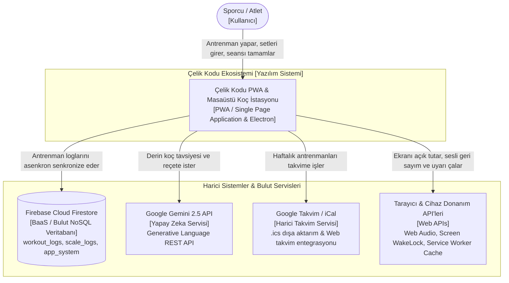
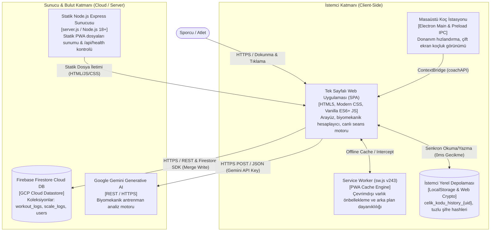
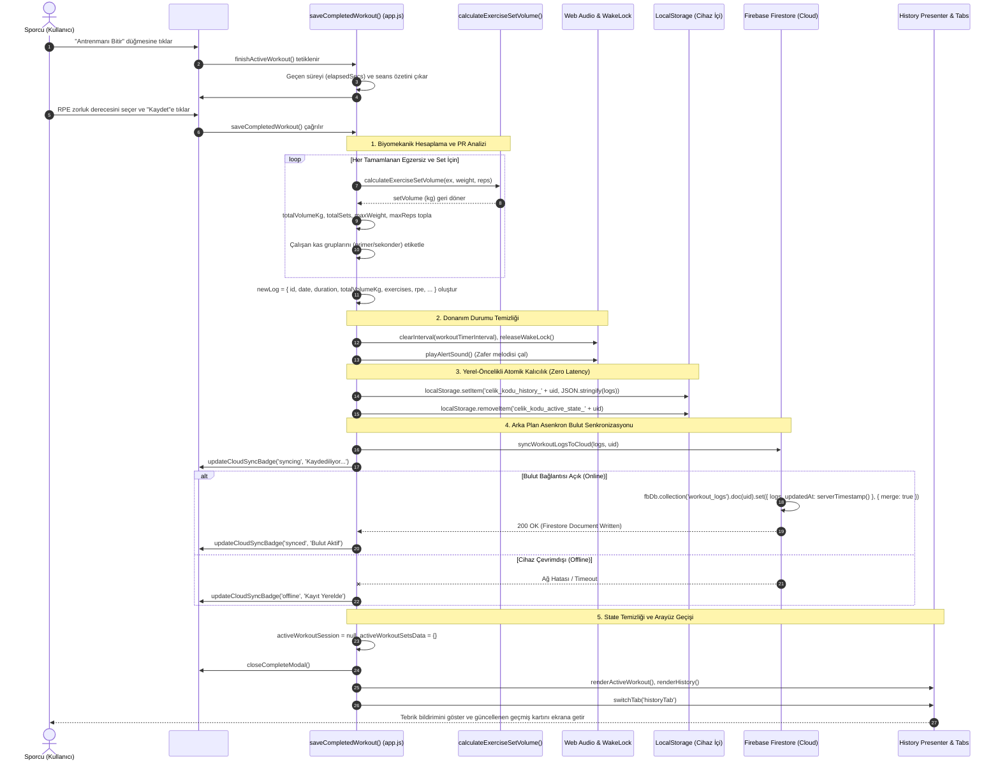

# Çelik Kodu — 4 Katmanlı C4 Mimari ve Olay Akışı Dokümantasyonu (C4_ARCHITECTURE.md)

Bu doküman, **Çelik Kodu (Fitness PWA & Desktop)** sisteminin en kritik işlevsel akışını C4 modelleme standardına göre (Context, Container, Component, Code/Flow) modeller.

---

## 1. En Kritik Sayfa ve Temel Etkileşim Butonu Tespiti

- **En Kritik Sayfa / Görünüm:** `#activeWorkoutTab` (Aktif Canlı Antrenman Seansı & Odak İstasyonu) + `#completeModal` (Seans Tamamlama & Biyomekanik Rapor Modalı)
- **Temel Etkileşim Butonu:** `#btnSaveCompletedWorkout` (**"Antrenmanı Bitir & Günlüğe Kaydet"** — `saveCompletedWorkout()`)

### Neden En Kritik?
1. **Nihai Veri Üretim Merkezi:** Sporcunun tüm ağırlık, tekrar, süre ve tükeniş verileri bu akışta toplanır.
2. **Biyomekanik Motor Entegrasyonu:** Kaldırılan toplam tonaj (kg), izometrik tutuş süresi, egzersiz bazlı PR (Kişisel Rekor) tespiti ve çalışan kas gruplarının (primer/sekonder) anatomik dağılımı burada hesaplanır.
3. **Cihaz Donanım Yönetimi:** Tarayıcının Screen WakeLock (ekran uyanık kalma) kilidi serbest bırakılır, dinlenme sayaçları durdurulur ve Web Audio API ile başarı melodisi çalınır.
4. **Hibrit Veri Mimarisi (Local-First & Cloud):** Sıfır gecikmeyle önce `localStorage` üzerine atomik olarak yazılır, ardından arka planda Firebase Firestore bulut veritabanına (`workout_logs/{uid}`) asenkron senkronize edilir.

---

## 2. Level 1: Sistem Bağlamı (System Context Diagram)

Sporcunun (atlet/kullanıcı) Çelik Kodu sistemiyle ve sistemin dış dünya servisleriyle (Firebase Firestore, Google Gemini AI, Google Takvim, Tarayıcı Donanım API'leri) olan üst düzey ilişkisini gösterir.

---

## 3. Level 2: Konteyner Mimarisi (Container Diagram)

Çelik Kodu sisteminin içindeki yüksek seviyeli yazılım konteynerlerini, sorumluluklarını ve veri akış protokollerini gösterir.

---

## 4. Level 3: Bileşen Mimarisi (Component Diagram — Aktif Seans & Kayıt)

`#activeWorkoutTab` ve `#completeModal` konteyneri içindeki temel mantıksal bileşenleri, veri yapılarını ve kontrolörleri modeller.

```mermaid
flowchart TD
    subgraph ViewComponents["Kullanıcı Arayüzü Bileşenleri (DOM View)"]
        ActiveTabUI["#activeWorkoutTab<br/>[Aktif Seans Görünümü]<br/>Odak Kartı / Liste Görünümü"]
        FinishBtn["#btnFinishWorkout<br/>[Antrenmanı Bitir Butonu]"]
        CompleteModalUI["#completeModal<br/>[Tamamlama Modalı]<br/>RPE, süre, konum, antrenör notu"]
        SaveBtn["#btnSaveCompletedWorkout<br/>[Kaydet & Günlüğe Yaz Butonu]"]
    end

    subgraph LogicComponents["İş Mantığı & Kontrolörler (Application Logic)"]
        WorkoutController["ActiveWorkoutManager (app.js)<br/>finishActiveWorkout(), saveCompletedWorkout()"]
        BiomechanicalEngine["Biomechanical Metric Engine<br/>calculateExerciseSetVolume(), PR Evaluator"]
        StateStore["Application State Store<br/>activeWorkoutSession, activeWorkoutSetsData"]
    end

    subgraph HardwareComponents["Donanım & Sistem Köprüsü (Hardware Services)"]
        AudioService["WebAudioService<br/>playAlertSound(), playWorkoutCompleteFanfare()"]
        WakeLockService["WakeLockManager<br/>releaseWakeLock(), requestWakeLock()"]
        TimerService["Interval Timer Service<br/>clearInterval(workoutTimerInterval)"]
    end

    subgraph PersistenceComponents["Veri ve Senkronizasyon Katmanı (Data Access)"]
        LocalStorageStore["LocalStorage Adapter<br/>setWorkoutLogs(), clearActiveState()"]
        CloudSyncManager["Firestore Sync Gateway<br/>syncWorkoutLogsToCloud(), updateCloudSyncBadge()"]
        HistoryPresenter["HistoryView Presenter<br/>renderHistory(), switchTab('historyTab')"]
    end

    FinishBtn -->|"onclick"| WorkoutController
    WorkoutController -->|"1. İstatistikleri hesapla & modalı doldur"| CompleteModalUI
    SaveBtn -->|"onclick"| WorkoutController

    WorkoutController -->|"2. Set tonajı ve hacim hesaplat"| BiomechanicalEngine
    WorkoutController <-->|"Aktif seans verisini oku/sıfırla"| StateStore
    WorkoutController -->|"3. Başarı melodisi çal"| AudioService
    WorkoutController -->|"4. Ekran uyanıklığını kapat"| WakeLockService
    WorkoutController -->|"5. Sayacı durdur"| TimerService

    WorkoutController -->|"6. Yerel depolamaya anında yaz"| LocalStorageStore
    LocalStorageStore -->|"7. Buluta asenkron aktar"| CloudSyncManager
    WorkoutController -->|"8. Geçmiş sekmesini yenile ve aç"| HistoryPresenter
```

---

## 5. Level 4: Kod & Olay Akışı (Code / Flow — Mermaid Sequence Diagram)

Sporcunun canlı antrenman ekranında "Antrenmanı Bitir" ve ardından "Kaydet" butonuna basmasıyla başlayan `Event -> Handler -> Metric Calculation -> Persistence -> Cloud Sync -> State Reset -> UI Re-render` akışının adım adım kod seviyesi sekansıdır.

---

## 6. Güvenlik, Dayanıklılık ve Mimari Prensipler

1. **Local-First & Offline Resilience (Sıfır Veri Kaybı):**
   - Ağ bağlantısı tamamen kopsa bile, antrenman kaydı anında `localStorage`'a yazılır ve aktif seans başarıyla tamamlanır. İnternet geri geldiğinde Firestore otomatik senkronize edilir.
2. **Kimlik & Veri İzolasyonu:**
   - Her kullanıcının antrenman geçmişi `celik_kodu_history_${uid}` ve Firestore `workout_logs/${uid}` anahtarlarıyla birbirine karışmayacak şekilde izole edilir.
3. **Donanım Tasarrufu (Battery & CPU):**
   - Seans bittiğinde hem `workoutTimerInterval` hem de `timerInterval` temizlenir; `releaseWakeLock()` ile telefon ekranının arka planda pili tüketmesi önlenir.
4. **Formula Injection Koruması:**
   - Kaydedilen loglar CSV olarak dışa aktarılırken, formül tetikleyebilecek metinlerin başına tek tırnak (`'`) eklenerek kullanıcı veri güvenliği sağlanır.
