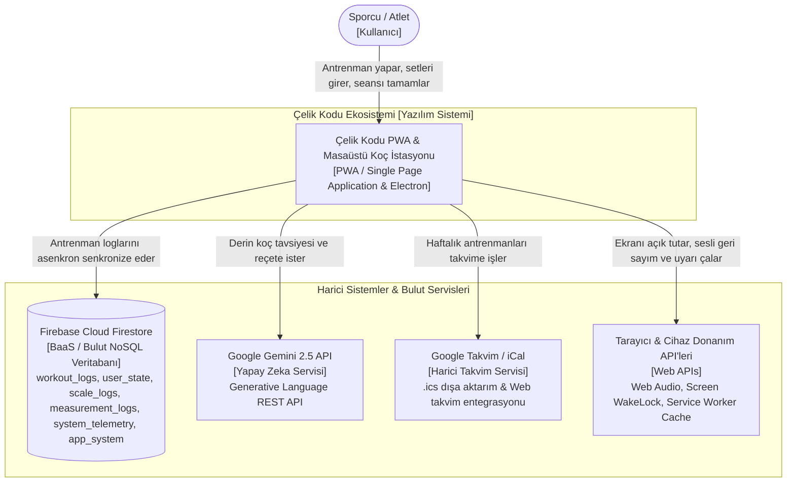
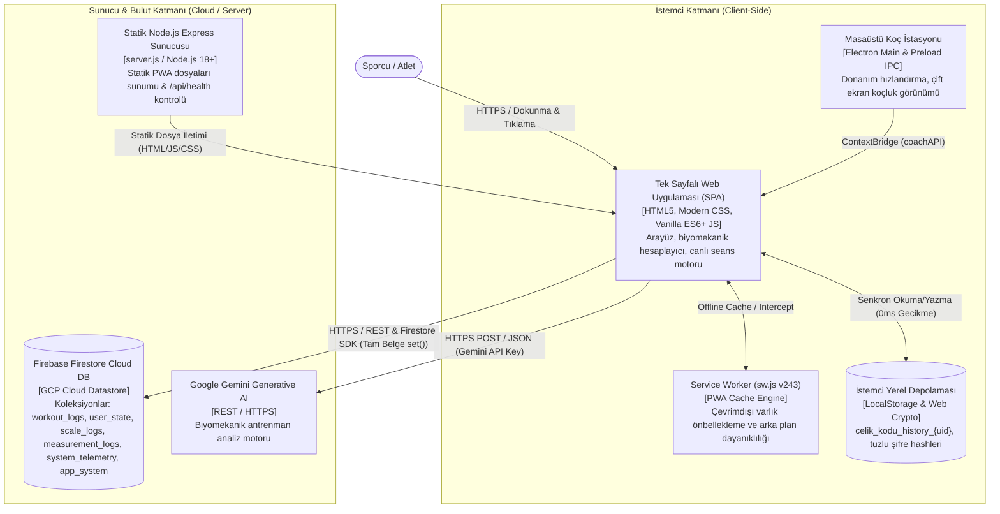
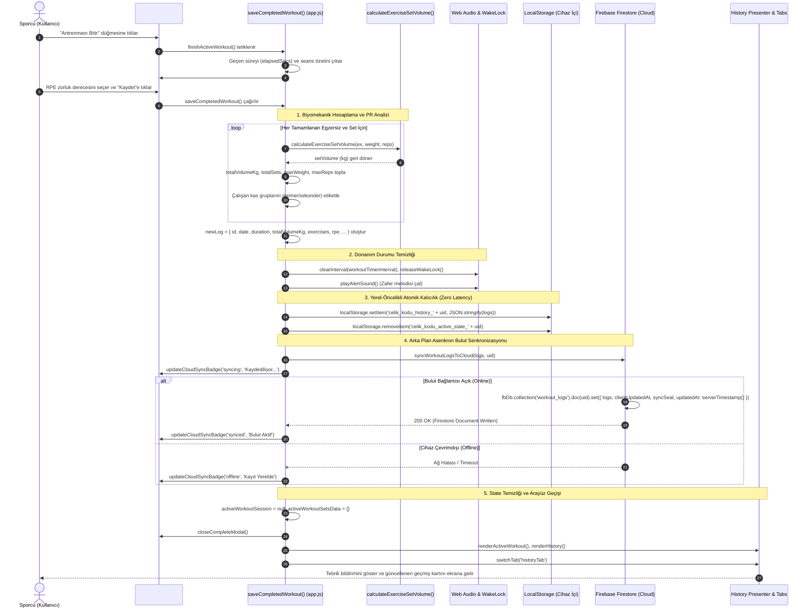
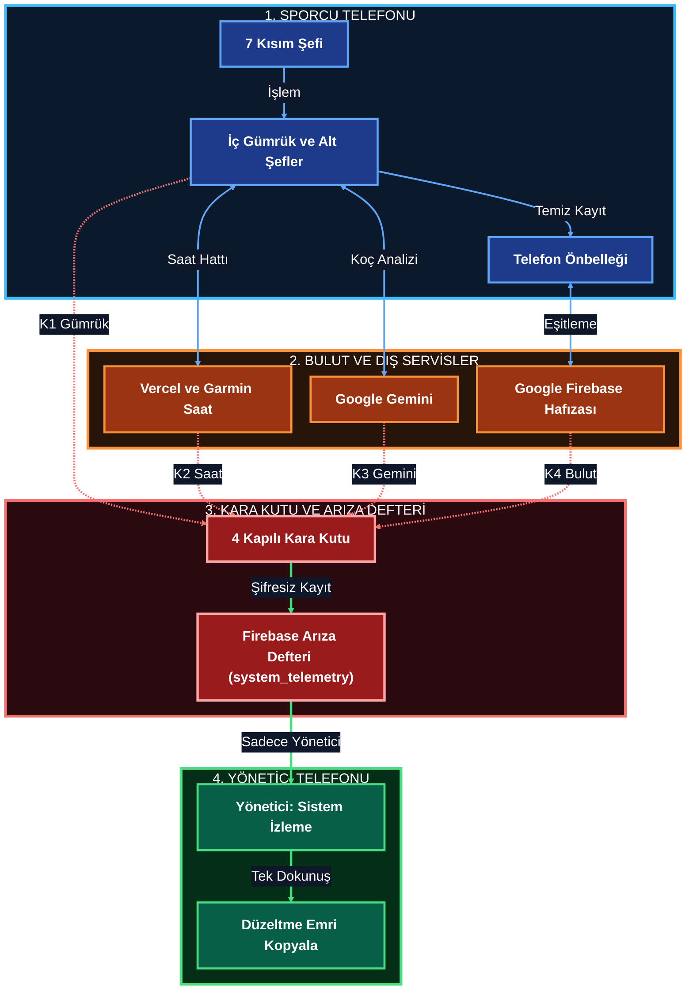
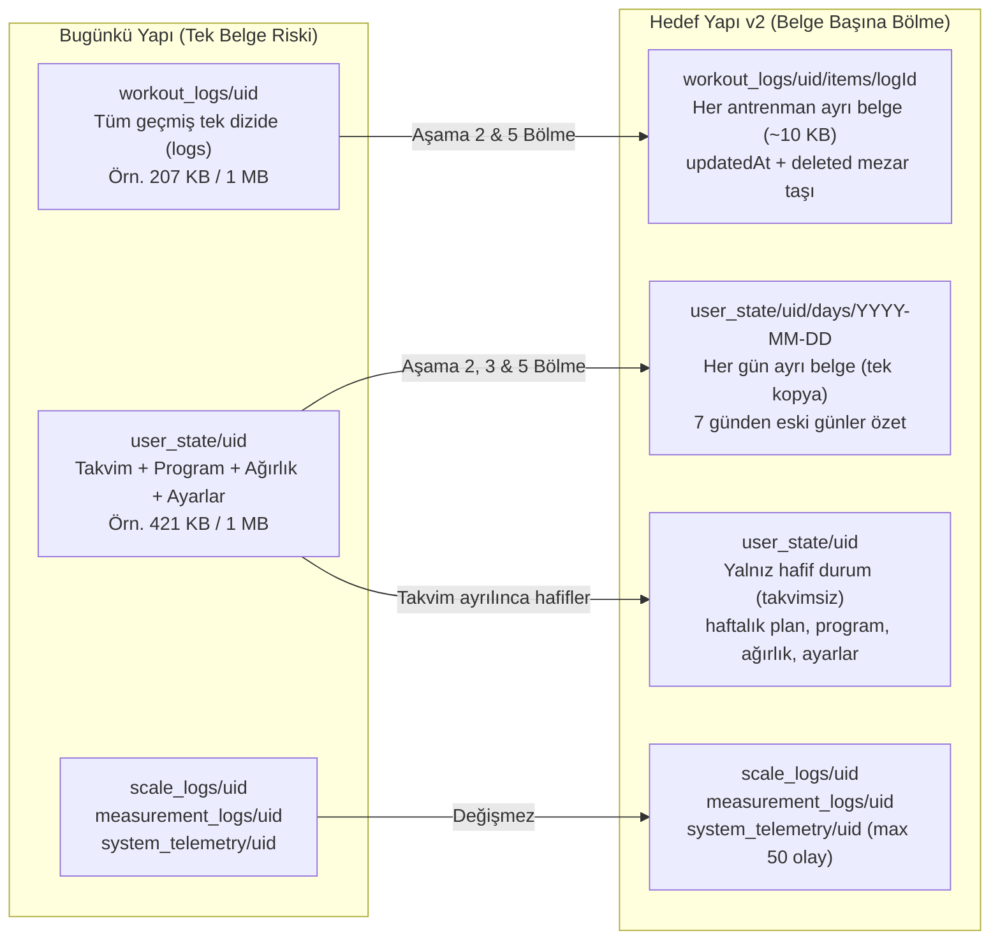
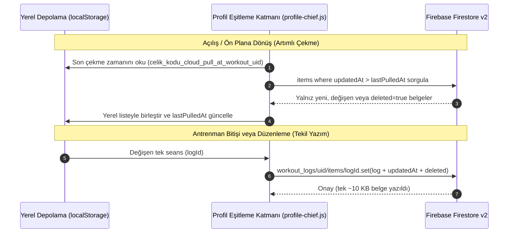

# Çelik Kodu — 4 Katmanlı C4 Mimari ve Olay Akışı Dokümantasyonu (C4_ARCHITECTURE.md)

Bu doküman, **Çelik Kodu (Fitness PWA & Desktop)** sisteminin en kritik işlevsel akışını C4 modelleme standardına göre (Context, Container, Component, Code/Flow) modeller.

---

## 1. En Kritik Sayfa ve Temel Etkileşim Butonu Tespiti

- **En Kritik Sayfa / Görünüm:** `#activeWorkoutTab` (Aktif Canlı Antrenman Seansı & Odak İstasyonu) + `#completeModal` (Seans Tamamlama & Biyomekanik Rapor Modalı)
- **Temel Etkileşim Butonu:** `#btnSaveCompletedWorkout` (**"Antrenmanı Bitir & Günlüğe Kaydet"** — `saveCompletedWorkout()`)

### Neden En Kritik?
1. **Nihai Veri Üretim Merkezi:** Sporcunun tüm ağırlık, tekrar, süre ve tükeniş verileri bu akışta toplanır.
2. **Biyomekanik Motor Entegrasyonu:** Kaldırılan toplam tonaj (kg), izometrik tutuş süresi, egzersiz bazlı PR (Kişisel Rekor) tespiti ve çalışan kas gruplarının (primer/sekonder) anatomik dağılımı burada hesaplanır.
3. **Cihaz Donanım Yönetimi:** Tarayıcının Screen WakeLock (ekran uyanık kalma) kilidi serbest bırakılır, dinlenme sayaçları durdurulur ve Web Audio API ile başarı melodisi çalınır.
4. **Hibrit Veri Mimarisi (Local-First & Cloud):** Sıfır gecikmeyle önce `localStorage` üzerine atomik olarak yazılır, ardından arka planda Firebase Firestore bulut veritabanına (`workout_logs/{uid}`, `user_state/{uid}`, `scale_logs/{uid}`, `measurement_logs/{uid}`, `system_telemetry/{uid}`) asenkron ve tam belge yazımıyla (`set()`) senkronize edilir.

---

## 2. Level 1: Sistem Bağlamı (System Context Diagram)

Sporcunun (atlet/kullanıcı) Çelik Kodu sistemiyle ve sistemin dış dünya servisleriyle (Firebase Firestore, Google Gemini AI, Google Takvim, Tarayıcı Donanım API'leri) olan üst düzey ilişkisini gösterir.

---

## 3. Level 2: Konteyner Mimarisi (Container Diagram)

Çelik Kodu sisteminin içindeki yüksek seviyeli yazılım konteynerlerini, sorumluluklarını ve veri akış protokollerini gösterir.

---

## 4. Level 3: Bileşen Mimarisi (Component Diagram — Aktif Seans & Kayıt)

`#activeWorkoutTab` ve `#completeModal` konteyneri içindeki temel mantıksal bileşenleri, veri yapılarını ve kontrolörleri modeller.

```mermaid
flowchart TD
    subgraph ViewComponents["Kullanıcı Arayüzü Bileşenleri (DOM View)"]
        ActiveTabUI["#activeWorkoutTab<br/>[Aktif Seans Görünümü]<br/>Odak Kartı / Liste Görünümü"]
        FinishBtn["#btnFinishWorkout<br/>[Antrenmanı Bitir Butonu]"]
        CompleteModalUI["#completeModal<br/>[Tamamlama Modalı]<br/>RPE, süre, konum, antrenör notu"]
        SaveBtn["#btnSaveCompletedWorkout<br/>[Kaydet & Günlüğe Yaz Butonu]"]
    end

    subgraph LogicComponents["İş Mantığı & Kontrolörler (Application Logic)"]
        WorkoutController["ActiveWorkoutManager (app.js)<br/>finishActiveWorkout(), saveCompletedWorkout()"]
        BiomechanicalEngine["Biomechanical Metric Engine<br/>calculateExerciseSetVolume(), PR Evaluator"]
        StateStore["Application State Store<br/>activeWorkoutSession, activeWorkoutSetsData"]
    end

    subgraph HardwareComponents["Donanım & Sistem Köprüsü (Hardware Services)"]
        AudioService["WebAudioService<br/>playAlertSound(), playWorkoutCompleteFanfare()"]
        WakeLockService["WakeLockManager<br/>releaseWakeLock(), requestWakeLock()"]
        TimerService["Interval Timer Service<br/>clearInterval(workoutTimerInterval)"]
    end

    subgraph PersistenceComponents["Veri ve Senkronizasyon Katmanı (Data Access)"]
        LocalStorageStore["LocalStorage Adapter<br/>setWorkoutLogs(), clearActiveState()"]
        CloudSyncManager["Firestore Sync Gateway<br/>syncWorkoutLogsToCloud(), updateCloudSyncBadge()"]
        HistoryPresenter["HistoryView Presenter<br/>renderHistory(), switchTab('historyTab')"]
    end

    FinishBtn -->|"onclick"| WorkoutController
    WorkoutController -->|"1. İstatistikleri hesapla & modalı doldur"| CompleteModalUI
    SaveBtn -->|"onclick"| WorkoutController

    WorkoutController -->|"2. Set tonajı ve hacim hesaplat"| BiomechanicalEngine
    WorkoutController <-->|"Aktif seans verisini oku/sıfırla"| StateStore
    WorkoutController -->|"3. Başarı melodisi çal"| AudioService
    WorkoutController -->|"4. Ekran uyanıklığını kapat"| WakeLockService
    WorkoutController -->|"5. Sayacı durdur"| TimerService

    WorkoutController -->|"6. Yerel depolamaya anında yaz"| LocalStorageStore
    LocalStorageStore -->|"7. Buluta asenkron aktar"| CloudSyncManager
    WorkoutController -->|"8. Geçmiş sekmesini yenile ve aç"| HistoryPresenter
```

---

## 5. Level 4: Kod & Olay Akışı (Code / Flow — Mermaid Sequence Diagram)

Sporcunun canlı antrenman ekranında "Antrenmanı Bitir" ve ardından "Kaydet" butonuna basmasıyla başlayan `Event -> Handler -> Metric Calculation -> Persistence -> Cloud Sync -> State Reset -> UI Re-render` akışının adım adım kod seviyesi sekansıdır.

---

## 6. Güvenlik, Dayanıklılık ve Mimari Prensipler

1. **Local-First & Offline Resilience (Sıfır Veri Kaybı):**
   - Ağ bağlantısı tamamen kopsa bile, antrenman kaydı anında `localStorage`'a yazılır ve aktif seans başarıyla tamamlanır. İnternet geri geldiğinde Firestore otomatik senkronize edilir.
2. **Kimlik & Veri İzolasyonu:**
   - Her kullanıcının antrenman geçmişi `celik_kodu_history_${uid}` ve Firestore `workout_logs/${uid}` anahtarlarıyla birbirine karışmayacak şekilde izole edilir.
3. **Donanım Tasarrufu (Battery & CPU):**
   - Seans bittiğinde hem `workoutTimerInterval` hem de `timerInterval` temizlenir; `releaseWakeLock()` ile telefon ekranının arka planda pili tüketmesi önlenir.
4. **Formula Injection Koruması:**
   - Kaydedilen loglar CSV olarak dışa aktarılırken, formül tetikleyebilecek metinlerin başına tek tırnak (`'`) eklenerek kullanıcı veri güvenliği sağlanır.

---

## 7. Güncel Sistem Mimarisi, 4 Kapılı Kara Kutu (`K1–K4`) ve Yönetici Sistem İzleme

7 Kısım Şefi, Köprü Gümrüğü, Vercel bulut köprü sunucusu, Garmin/Tredict saat hattı, Google Gemini ve Google Firebase bulut veritabanı arasındaki güncel veri ve hata yakalama akışı:

- **Kara Kutu Kapıları:** `K1` (Şefler & Köprü Gümrüğü & Çalışma Zamanı), `K2` (Vercel & Garmin/Tredict Saat Hattı), `K3` (Google Gemini Yapay Zeka), `K4` (Google Firebase Bulut Eşitleme).
- **Bulut Bağlantı Alt Şefi:** Mevcut 7 Bağlantı Alt Şefi (`js/chiefs/liaison-subchiefs.js`) içinde bulut kota/zaman aşımı/tasarruf sayacını, 1 MB belge doluluk oranını ve v2 zarf geçiş durumunu canlı takip eder; **Sistem İzleme** sekmesinde özet karne ve tek dokunuşla **Bulut Raporu Kopyala** çıktısı üretir.
- **Gizlilik ve Tampon Sınırı:** Tüm parola, `syncSeal`, Gemini API anahtarı ve saat tokenları maskelenir; sporcu başına son 50 olay saklanır; `system_telemetry/{uid}` yalnızca sahibi veya Yönetici tarafından okunabilir.
- **Yönetici Portalı:** `#adminModal` içindeki **Sistem İzleme** sekmesinden kapı/arıza filtresiyle canlı incelenir, tek dokunuşla AI düzeltme emri veya Bulut Raporu kopyalanır.

---

## 8. Bulut Veri Mimarisi v2 — Belge Başına Bölme (Aşama 1–6 Yerelde Doğrulandı: T62–T67)

Tek Firestore belgesindeki **1 MB kalıcı boyut sınırını** aşmamak ve her güncellemede tüm geçmişin/takvimin baştan yazılmasını önlemek için uygulanmış v2 hedef mimarisidir. Cihaz içi `localStorage` anahtarları aynı kalır; yalnızca bulut senkronizasyon katmanı (`profile-chief.js`), takvim saklama biçimi ve güvenlik kuralları güncellenmiştir.

### 8.1 Bugünkü Yapı vs. Hedef Yapı

### 8.2 Artımlı Okuma ve Tekil Belge Yazımı Akışı

### 8.3 Canlı Veritabanı Ölçümü (22 Kasım 2026, 14:11)

| Belge | Mevcut Boyut | İçerik Ayrıntısı |
|---|---|---|
| `workout_logs/usr_admin` | **207 KB** | 21 antrenman, ortalama 9,9 KB (~100 antrenmanda 1 MB dolar) |
| `workout_logs/usr_ferit` | **50 KB** | 11 antrenman, ortalama 4,6 KB |
| `workout_logs/usr_ismail` | **8 KB** | 2 antrenman, ortalama 4,0 KB |
| `user_state/usr_admin` | **421 KB** | `dateSchedule` 263 KB, `weeklySchedule` 83 KB, `customPrograms` 37 KB, `garminManifests` 23 KB |

### 8.4 Okuyucu Modüller ve Takvim Sadeleştirme Özeti
- **Etkilenmeyen bölümler:** Analiz (`analytics-chief.js`), Geçmiş (`history-chief.js`), Antrenman (`workout-chief.js`), Kütüphane (`library-chief.js`), Ortak Çekirdek (`shared-core.js`) ve Yönetici Portalı (`admin-portal.js`) veriyi yerelden okumayı sürdürür.
- **Tek kopya takvim:** Gün içi çifte kayıt (`exercises` tekrarı) kaldırılır, yalnızca `customWorkout` tutulur (okuyucular zaten buna düşer).
- **7 günlük tam pencere:** Üretici'nin dünkü kas koruması ve Saat Köprüsü'nün 7 günlük aktivite eşleşmesi için son 7 gün + gelecek günler tam ayrıntıda kalır; 7 günden eski günler `{type, title, rest, desc, extraCardioSessions, primarySubKeys, updatedAt}` özetine indirilir.

### 8.5 Geçiş, Güvenlik Kuralı ve Geri Dönüş İlkeleri
- **Yerel Uygulama Durumu (`T62`–`T67`):** Aşama 1–6 ve Bulut Alt Şefi yerel diskte tamamlanmış, gerçek veri karşılaştırması dahil bekçi sınavlarıyla doğrulanmıştır (`T62` kota/zaman aşımı ayrımı, `T63` belge başına artımlı eşitleme, `T64` tek kopya ve 7 günlük takvim özetleme, `T65` iki eşit güvenlik kuralı dosyası, `T66` yönetici öncelikli kademeli taşıma ve tek adımda geri dönüş, `T67` Bulut Alt Şefi canlı karnesi ve v2 taşıma öncesi/sonrası kas/puan birebir sağlaması); canlı dağıtım kullanıcı onayı sonrasına ayrılmıştır.
- **Güvenlik kuralları (Aşama 4):** `workout_logs/{uid}/items/{logId}` ve `user_state/{uid}/days/{dateStr}` için yalnız sahibi/yönetici okuyup yazabilir kuralı `firestore.rules` ve `config/firestore.rules` dosyalarına birebir aynı şekilde işlenmiştir.
- **Taşıma ve yedek (Aşama 5):** `migrateLegacyAthleteDocsToSubcollections` eski büyük belgeleri silmeden alt belgelere böler; eski belgeler en az **30 gün** boyunca silinmeden yedek ve `rollbackUserSubcollectionMigration` ile tek adımda geri dönüş yolu olarak korunur.
- **Kademeli canlı çıkış:** Önce yalnızca yönetici hesabında (`usr_admin`) devreye alınıp 2–3 gün izlenir; sorunsuz doğrulamanın ardından `setV2SubcollectionRolloutAll(true)` ile diğer 2 sporcu hesabı geçirilir.
